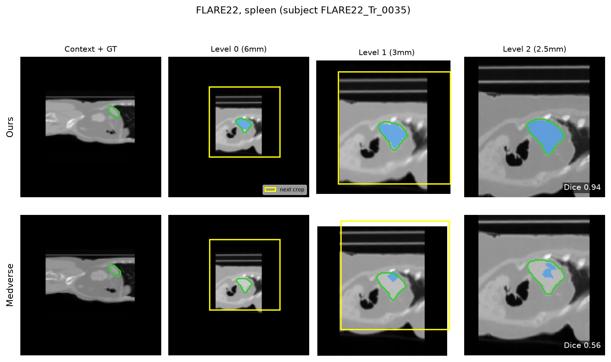
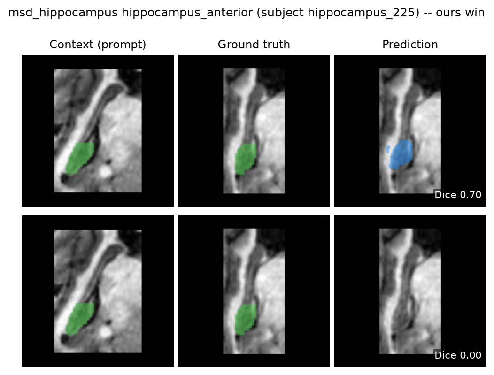

## PatchICL

In-context 3D medical image segmentation: given a target CT/MRI volume and K context
(image, mask) pairs for the same organ, predict a mask for the target. Primary dataset is
TotalSegmentator (CT + MRI); also trains/evals on several OOD sources (ISLES22, Shifts-MS,
ATLAS v2, GNC_705, NasalSeg, ...).

## Results

Coarse-to-fine cascade vs. Medverse (matched refinement steps, 6 non-lesion held-out
datasets): **~17x faster** (206ms vs. 3491ms/sample, sample-weighted) and **more
accurate on average** (Dice 0.526 vs. 0.393), winning 4/6 datasets. Lesion
segmentation remains below 0.1 Dice for both models on all 4 lesion datasets tested.
Full writeup in `results/publications/thesis/ics_3d_medical/`.

| Dataset | Spacings (mm) | Dice (ours) | Dice (Medverse) | Latency (ours) | Latency (Medverse) |
|---|---|---|---|---|---|
| FLARE22 | 6, 3, 2.5 | **0.751** | 0.359 | 311ms | 4894ms |
| MSD Prostate | 3, 1.5, 0.75 | **0.375** | 0.357 | 279ms | 5006ms |
| MSD Hippocampus | 0.5 | 0.303 | **0.686** | 99ms | 50ms |
| HU_LWK1 | 6, 3, 1 | **0.152** | 0.020 | 439ms | 5336ms |
| TotalSeg MRI | 6, 3, 1.5 | **0.503** | 0.055 | 194ms | 5188ms |
| NasalSeg | 1.5, 0.8 | 0.547 | **0.737** | 161ms | 1886ms |
| **Mean (sample-weighted)** | | **0.526** | 0.393 | **206ms** | 3491ms |

Crop placement across cascade levels, ours vs. Medverse (FLARE22 spleen):



Qualitative win on MSD Hippocampus, hippocampus_anterior (top: ours, Dice 0.70;
bottom: Medverse, Dice 0.00):



## Inference

Run the trained cascade on real nifti files, works from the shared `patchset` conda env. Full usage: `docs/inference_cli.md`.

```bash
conda activate patchset

# one target
patchset-infer \
  --target tgt_ct.nii.gz \
  --context ctx_ct.nii.gz ctx_mask.nii.gz \
  --checkpoint /nfs/.../best.pt \
  --out pred.nii.gz [--gt gt_mask.nii.gz]
  --labels 1,5,13 # default : all 
  --batch-size 4

# multiple targets, one checkpoint load 
# (JSON-Lines manifest, see docs/inference_cli.md)
patchset-infer --manifest tasks.jsonl --checkpoint /nfs/.../best.pt --out-dir preds/

# additional flags
#   --crop-spacings S0,S1   coarse->fine FOV schedule in mm/voxel (default 4,1.5)
#   --gpu-realize-crop     GPU-side crop resample, ~25-35% faster on multi-label runs
#   --recrop-workers N     thread fan-out for crop loading, ~2x faster on the plain CPU path
```


### Add nifti files to a nora project 

```bash
# from the project's filesytem
nora -p camaret___in_context_segmentation --add pred.nii.gz

# outside of the project's filesytem
nora -p camaret___in_context_segmentation --importfiles \
  /nfs/data/nii/data1/camaret___in_context_segmentation/10276934/20250926154617/ML/pred.nii.gz \
  "(?<patients_id>\d+)/(?<studies_id>\d+)/ML/" \
  "ML/"
```

### Creating the `patchset` env

Ampere nodes only (nero, thor, loki — see `requirements-patchset-infer.txt`). **Install
torch first, then `dynamic_network_architectures` with `--no-deps`**

```bash
conda create -n patchset python=3.11 -y
conda activate patchset
pip install "torch==2.6.0" "torchvision==0.21.0" --extra-index-url https://download.pytorch.org/whl/cu124
pip install --no-deps dynamic_network_architectures==0.4.4 einops timm
pip install numpy scipy nibabel matplotlib tqdm "hydra-core>=1.3" "omegaconf>=2.3" wandb  # rest of requirements-patchset-infer.txt

python -c "import torch; assert torch.backends.cudnn.version() == 90100"  # sanity check

bash scripts/sync_patchset_env.sh   # populate code + create the patchset-infer launchers
```

## Training/eval environment

```bash
# Ampere nodes (nero, thor, loki) -- cu124
UV_PROJECT_ENVIRONMENT=.venv_thor uv sync --extra cu124

# Blackwell (odin, sm_120) -- needs cu128
UV_PROJECT_ENVIRONMENT=.venv_blackwell uv sync --extra cu128
```


## Data prep

```bash
python scripts/convert_to_npy.py --size 128 128 128        # nii.gz -> pre-resized .npy per subject
python scripts/synth_labels/generate.py --method slic --union --overwrite --size 128 128 128 --workers 16
```

## Training

`experiments/3d/train.py`, Hydra-configured

```bash
python experiments/3d/train.py                                    # medverse on totalseg (default)
python experiments/3d/train.py dataset=omnisynth3d                # train on omniSynth-3D
python experiments/3d/train.py train.epochs=10 data.max_train_subjects=50   # quick debug run
python experiments/3d/train.py train.checkpoint=results/checkpoints/best.pt # resume
python experiments/3d/train.py experiment=168_cascade_real_host_all_shapes
```

## Eval / benchmark

```bash
python experiments/3d/eval.py                                      # medverse on totalseg (test)
python experiments/3d/eval.py eval.model=patchset3d eval.checkpoint=/nfs/.../best.pt
python experiments/3d/eval.py dataset=omnisynth3d eval.split=val    # eval on omniSynth-3D

```

## More details

- `docs/inference_cli.md` — full inference CLI reference
- `docs/logs.md` — dev log, the actual source of truth for "how was X done / what command
  produced result Y"
- `docs/datasets/` — per-dataset conversion/eval notes
